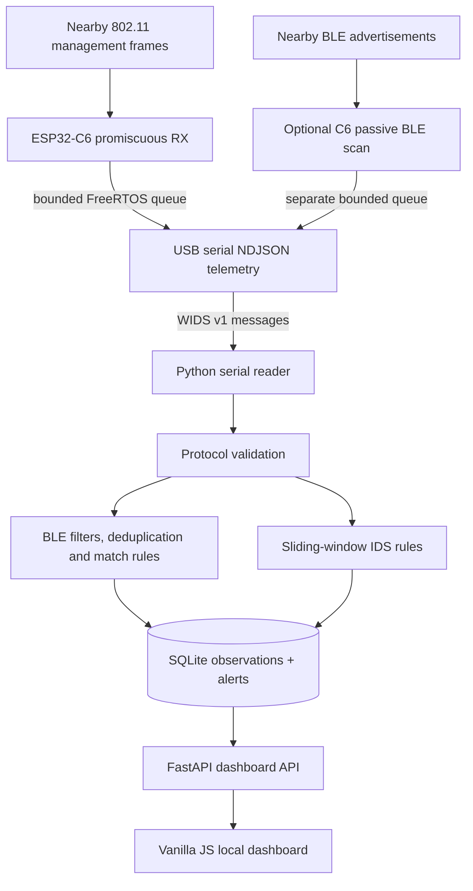

# WiFi Sentinel

**Receive-only ESP32-C6 wireless intrusion detection sensor + Raspberry Pi 4 / Fedora collector**

   

> **Tested hardware:** ESP32-C6 revision v0.0 with native USB Serial/JTAG, connected to a Raspberry Pi 4 Model B Rev 1.2. ESP-IDF v5.5.4 build/flash, live 2.4 GHz Wi-Fi and passive BLE advertisements, runtime controls and reboot persistence have been exercised. The exact sensor board product/PCB and antenna remain unidentified. Optional C5/5 GHz support is unvalidated; the connected C6 is **2.4 GHz only**. See [hardware evidence](docs/HARDWARE.md) and [validation limits](docs/VALIDATION.md).

WiFi Sentinel passively captures **802.11 management-frame metadata** and optional **Bluetooth Low Energy advertisements**, reports events via USB serial, and applies explainable rules in a Python collector. It does **not** inject frames, disconnect clients, attempt logins, crack passwords, decode user traffic, or perform countermeasures.

## Scope

| Feature | State | Notes |
|---|---|---|
| Passive deauthentication/disassociation monitoring | Implemented in source | Requires board hardware validation |
| Authentication/association monitoring | Implemented in source | 802.11 management status, not WPA password success |
| Fixed-channel 2.4 GHz selection | Tested on C6 | One channel at a time; optional C5/5 GHz path is unvalidated |
| Protected SSID / unfamiliar BSSID alert | Implemented | Heuristic; configured allowlists needed |
| Passive legacy BLE advertisements | Tested on C6 | Optional passive LE 1M scan, raw AD bytes, names, services and manufacturer data; shared radio limits simultaneous coverage |
| BLE filters, alerts and retention | Implemented and tested | Exact rules, bounded duplicate/cooldown caches and independent record/time limits |
| Dedicated BLE dashboard tab | Implemented and tested | After Devices; rolling one-hour count, advertiser summaries, latest advertisements and clickable details |
| Sensor IDs and replay | Implemented | One live USB port per collector process; multi-port fan-in is a roadmap item |
| Local web UI / API / SQLite | Implemented | Localhost binding, no login interface |
| Synthetic demonstration and deterministic tests | Implemented | No RF attacks generated |
| Live C6 RF/USB sanity check | Exercised | High-traffic performance, accuracy and PMF remain unvalidated |
| Channel hopping, true RF jamming detection, EAPOL parsing, PCAP | **Out of scope** | Not promised |

## Quick start: software-only demonstration (Fedora, Raspberry Pi OS, macOS, Linux)

```bash
unzip wifi-sentinel.zip
cd wifi-sentinel/collector
python3 -m venv .venv
source .venv/bin/activate
python -m pip install -e '.[dev]'

# Writes simulated frames/alerts to collector/sentinel.sqlite3:
wifi-sentinel demo

# Start dashboard. Without WIDS_SERIAL_PORT this is demo-only:
wifi-sentinel serve
```

Open **http://127.0.0.1:8181**. The synthetic dataset exercises Wi-Fi authentication,
deauthentication, disassociation and unsuccessful authentication-response rules.
For a software-only BLE example, see [BLE replay](docs/BLE.md#software-only-example).

Run tests:

```bash
python -m pytest -q tests
```

## Hardware steps

The tested sensor is an ESP32-C6, with native USB Serial/JTAG and 2.4 GHz capture.

1. Identify the chip/USB serial and exact board where possible; see [Hardware](docs/HARDWARE.md).
2. Install the tested ESP-IDF v5.5.4 toolchain for `esp32c6`.
3. `cd firmware && idf.py set-target esp32c6 && idf.py menuconfig`.
4. Choose a permitted 2.4 GHz channel and sensor ID. C6 defaults select USB Serial/JTAG and channel 6.
5. Set `SENSOR_PORT` to the **verified** `/dev/serial/by-id/...` path, then run `idf.py build && idf.py -p "$SENSOR_PORT" flash monitor`. Stop any collector using that port first.
6. Verify `WIDS` heartbeats and sampled beacons, then stop the serial monitor.
7. Configure `WIDS_SERIAL_PORT` with the same by-ID path and start the collector. This installation's other ESP currently uses `/dev/ttyACM0`; do not flash or open it.

8. For BLE, upgrade the collector before the firmware, open **Configuration**,
   enter the configuration key, enable BLE and apply sensor settings. Check
   **Status**, then open **BLE** to the right of Devices. New sensors default to
   BLE disabled; saved NVS values override that default. See [BLE setup](docs/BLE.md).

The source also includes optional C5/5 GHz support; it has not been hardware-validated and is not the connected sensor.

See **[Firmware](firmware/README.md)**, **[Fedora setup](docs/FEDORA_SETUP.md)**, **[Pi setup](docs/RASPBERRY_PI.md)** and **[Validation](docs/VALIDATION.md)**.

## Architecture



The radio is **receive-only by application design**: firmware configures STA mode but never joins a network. Monitoring a network does not require its Wi-Fi password. Wi-Fi user-packet payloads, handshake secrets and credentials are not persisted.
BLE observations retain up to 31 raw advertising-data bytes, which can include
names, service identifiers and manufacturer data. Wi-Fi and BLE share the C6
radio; simultaneous capture is best effort, not reliable full coverage. The single radio cannot observe multiple channels simultaneously. Two sensors on two channels provide better continuity than hopping across both.

## Repository map

```text
wifi-sentinel/
├── firmware/                 ESP-IDF C6 receiver; optional C5 target
│   ├── main/main.c           Frame parsing, beacon sampling, queue, NDJSON
│   ├── main/ble_monitor.c    Passive BLE scanner, bounded queue and counters
│   └── main/Kconfig.projbuild Band, channel, sensor ID, heartbeat
├── collector/
│   ├── wids/                 Protocol, detection engine, storage, CLI, API
│   ├── wids/static/index.html Offline-friendly self-contained web UI
│   ├── tests/                Deterministic Python tests
│   └── pyproject.toml        Dependencies / console script
├── config/collector.env.example
├── docs/                     Detailed architecture, hardware, protocols,
│                             threat model, setup and validation
├── examples/                 Sample NDJSON events and local replay
├── scripts/                  Fedora/Pi bootstrap helper scripts
├── systemd/                  Optional user service template
└── LICENSE
```

## Detection rules

- `deauth_flood`: default 20 observed deauth frames / 10 seconds / sensor/BSSID/channel.
- `disassoc_flood`: default 20 observed disassociation frames / 10 seconds.
- `auth_flood`: default 40 observed authentication frames / 10 seconds.
- `failed_auth_burst`: default 12 nonzero 802.11 authentication/association *status codes* / 10 seconds. **Not equivalent to detecting WPA password-guessing**.
- `protected_ssid_untrusted_bssid`: received beacon/probe response advertises one of your protected SSIDs from a BSSID not in your trusted allowlist. Could be a legitimate new AP; investigate before attributing.
- `ble_match`: optional exact name, advertiser address, service UUID or company-ID
  rule; disabled until configured. Cooldown applies per sensor and BLE rule,
  across advertiser addresses. A match is an observation, not proof of an attack.

Collector policy has environment defaults and persistent Configuration controls,
with 60-second repeat-alert cooldowns by default. BLE radio enable and timing are
sensor settings saved in NVS. No automated response. See [Detection design](docs/DETECTION.md).

## Responsible scope and data handling

Only monitor networks for which you have authority. Wi-Fi metadata and BLE advertisements contain addresses, names and potentially
identifying service/manufacturer data and may be personal information. Retain only what you need, secure the Pi filesystem, and avoid sharing raw logs publicly. Wi-Fi and BLE observations/alerts expire after 7 days by default, with independent
BLE retention and a 100,000-record cap per BLE table; attached sensor identity and last-seen information persists until removed. **Dashboard reads have no authentication; configuration writes require a key** and intentionally binds to `127.0.0.1` unless explicitly changed. Use SSH forwarding or a properly protected reverse proxy for remote access. See [Security](SECURITY.md).

## Documentation

- [Dashboard tabs, device observations and animation](docs/DASHBOARD.md)
- [BLE monitoring, setup, rules and shared-radio limits](docs/BLE.md)
- [BLE explorer, readable identification and operator aliases](docs/BLE_EXPLORER.md)
- [Approximate RSSI distance-decay plot and calibration](docs/BLE_RANGING.md)
- [Clickable MACs, vendor details and red alert sources](docs/MAC_LOOKUP.md)
- [Dashboard Configuration and Status dialogs](docs/CONFIGURATION.md)

- [Architecture and data flow](docs/ARCHITECTURE.md)
- [Tested hardware, BOM, board unknowns and scaling](docs/HARDWARE.md)
- [Fedora development and ESP-IDF setup](docs/FEDORA_SETUP.md)
- [Raspberry Pi 4 deployment](docs/RASPBERRY_PI.md)
- [Detection methodology, tuning and false positives](docs/DETECTION.md)
- [JSON telemetry protocol](docs/PROTOCOL.md)
- [Security, privacy and threat model](SECURITY.md)
- [Validation checklist, known issues and acceptance criteria](docs/VALIDATION.md)
- [Operations, backup, troubleshooting](docs/OPERATIONS.md)
- [Roadmap](docs/ROADMAP.md)
- [Authoritative upstream references](docs/REFERENCES.md)

## Version and contributions

**Release v1.2.0** (hardware validation remains at prototype scope), MIT licensed. Contributions welcome via PR; run unit tests, review changes for passive-only operation, and document real hardware test results. Run the Python and browser checks locally; no GitHub CI checks were reported for recent PRs. Firmware compilation is a separate manual validation task because the current archive does not bundle the ESP-IDF toolchain.

## Bluetooth Low Energy monitoring

Open **BLE** after **Devices** for its rolling one-hour observation count, advertiser
summaries and latest advertisements. **Devices** and **Reporting** show Wi-Fi
data. Configuration and Status cover both radios; Alerts includes optional BLE
rule matches. Passive legacy LE 1M scanning excludes Bluetooth Classic, extended
advertisements and active scan responses. Random BLE addresses are not submitted
for MAC vendor lookup. See [BLE configuration, limits and interpretation](docs/BLE.md).

### BLE explorer and approximate range — post-v1.2 enhancements

The BLE tab now offers readable evidence-based labels, offline Bluetooth SIG
company/service names, protected aliases/notes, search/filter/sort controls and
an advertiser workspace. Select a label to see its RSSI distance-decay model,
calibration controls and optional median. Distances are explicitly approximate
and uncalibrated until you supply a reference; no physical accuracy is claimed.
These #28/#29 additions require the updated collector/dashboard and are not in
the original v1.2.0 archive. Existing sensor firmware and Pi networking are unchanged.
