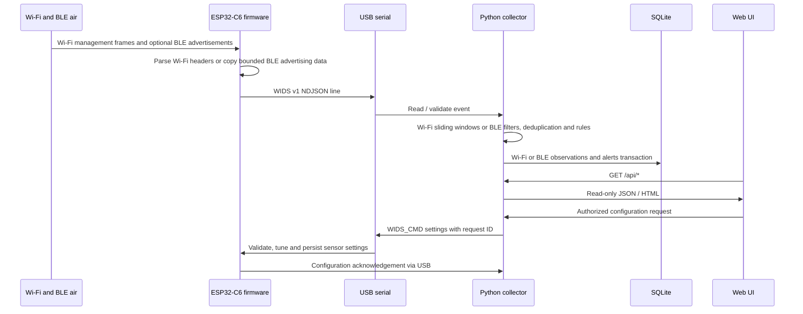

# Architecture and design decisions

## Goals

Create a cheap, reproducible, receive-only Wi-Fi IDS and optional BLE advertisement monitor with independent RF sensors and a local desktop/SBC dashboard. Prioritise **correct characterization** of observations (not attack certainty) and long-term maintainability over sophisticated but unvalidated RF claims.

## Data plane

## Firmware components

1. `app_main` initializes NVS/event loop/Wi-Fi in STA receive mode without connecting.
2. C6 captures 2.4 GHz only. The optional C5 path uses `esp_wifi_set_band_mode` for 2.4/5 GHz; C5 hardware remains unvalidated.
3. `esp_wifi_set_channel` tunes a fixed primary channel (requires regulatory/hardware validation).
4. A promiscuous management-frame callback checks subtype, copies key header fields, optionally extracts a beacon/probe SSID and queues a small fixed struct. No logging or blocking in RX callback.
5. FreeRTOS export task serializes frames to a versioned ASCII `WIDS ` + JSON line protocol. A periodic heartbeat exposes queue drops. `WIFI_PKT_DATA` and `WIFI_PKT_CTRL` are not captured or exported.

Sampled beacons mean beacon frequency counts are **not** a reliable detection
metric. Sampling uses a fixed table of 64 BSSID/channel entries, each with
independent beacon and probe-response counters. The first observation of a new
entry/type is exported immediately, then one after each N further observations
of that identity/type. At N=20 the selected positions are 1, 21, 41, and so on.
This prevents periodic traffic from other APs or the other subtype from locking
an AP out through a global counter phase.

The callback owns this table, scans at most 64 entries, and performs no allocation,
I/O or waiting in the sampler. When full, FIFO replacement resets the evicted
entry's state: a returning identity is reported immediately. Churn can therefore
increase exports above the steady-state one-in-N rate; the existing bounded
telemetry queue and dropped counter remain essential. Sampling does not prevent
RF/driver/USB loss or guarantee every varying SSID payload from one BSSID is seen.

## Collector components

- `models.py` validates wire framing/version/addresses/channel/rssi/subtypes.
- `engine.py` owns a single lock for deterministic ordering, detector and DB inserts. A dedicated retention worker attempts cleanup every 60 seconds independently of serial traffic, using the same lock for policy consistency. The web lifespan stops and joins workers before closing SQLite.
- `detection.py` observes sliding windows keyed by sensor + BSSID + channel + category. Rules are detection heuristics; they do not authenticate transmitter identity.
- `storage.py` uses SQLite WAL and a lock. No external brokers/database needed for a single sensor. Serialized writes simplify correctness for modest telemetry volume.
- `webapp.py` serves dashboard data, a Status dialog, and key-protected configuration writes with same-origin checks.
- `runtime.py` validates and atomically persists collector overrides; `sensor.py` coordinates USB commands and matching acknowledgements through the serial reader. See [configuration](CONFIGURATION.md).
- `cli.py` provides `serve`, `demo`, `replay` workflows. Demo/replay write to SQLite, **not** RF.

## Design trade-offs

| Choice | Reason | Cost |
|---|---|---|
| USB serial instead of ESP radio uplink | Reserve radio for passive capture | Tether or USB host required |
| Fixed channel instead of hopping | Fewer missed short bursts | Sensor per channel for full coverage |
| ESP-IDF/C instead of Arduino | Direct access to supported Wi-Fi APIs, bounded capture callback | SDK/toolchain overhead |
| Python/FastAPI/SQLite on Pi | Fast local iteration; explainable code | Not for large multi-site event volumes |
| Wi-Fi metadata and bounded BLE advertising data | Limit storage to observation evidence | BLE names and manufacturer data can still identify devices, no PCAP-level forensics |
| Heuristic rules | Explainability and testability | False positives / blind spots |
| No transmission/injection | Pure monitoring with lower disruption risk | No active containment |

## One serial input per running collector

The repository's **default** `serial_loop` reads one port. `sensor_id` supports multi-sensor events via replay, but multi-port live fan-in is a roadmap item. Multiple independent collector processes each with their own SQLite can operate concurrently; do **not** point separate processes at the same DB without explicitly engineering shared ownership/ingest ordering. An easy deployment is one Pi per sensor or an extension to launch multiple serial threads sharing one `Engine`.

## Time and measurement quality

The ESP sensor supplies monotonic uptime in milliseconds. It does **not** have authenticated UTC time. The Python host adds UTC receive timestamps (not original RF capture timestamps) when storing. All time-window rules run against **collector ingest time** rather than firmware uptime or packet timestamp. Delays/USB buffering can distort bursts. Tests and acceptance checklist should measure the practical effect before interpreting counts as reliable attack rates.

## Production hardening path

Do not expose the prototype over the WAN. Add authenticated sensor transport, centrally managed identities, structured logs and metrics, a real network time model, collection backpressure management, and rigorous target-hardware compilation + RF test coverage before any wider deployment.

## Optional BLE path

`ble_monitor.c` uses NimBLE observer-only passive legacy scanning, a separate
64-entry queue and a 20-report/second USB ceiling. The existing export task owns
all WIDS output and runtime commands. Radio coexistence is enabled; simultaneous
Wi-Fi sniffing and BLE scanning remains best effort on the C6 shared radio.
`ble.py` validates/decode advertisements, applies exact observation/alert rules
and bounded duplicate/cooldown caches. SQLite uses separate indexed BLE tables
with independent retention and record caps. The dedicated BLE tab follows
Devices and loads BLE counts, advertiser summaries and recent reports only when
active. Shared Alerts includes both protocols; Configuration and Status expose
BLE controls and health. BLE identities include address type;
they are not merged into Wi-Fi AP/client roles. See [BLE monitoring](BLE.md).

Wi-Fi storage remains header metadata; the BLE path additionally retains up to
31 raw advertising-data bytes per observation, never connection payloads/PCAPs.

## BLE explorer enrichment and model

`ble_identity.py` caches an attributed offline company/service snapshot and
produces evidence/provenance labels without online lookups or cross-address
correlation. SQLite stores aliases/notes under a composite sensor/address/type
key; bounded, authorized writes do not reset detection. A nullable local-name
column plus partial named/identity indexes supports name preservation and
sensor-specific history. Filtered list candidates are streamed before applying
the result cap; full candidate sets are not retained in process memory.

The selected-advertiser workspace requests up to 100 exact-identity samples.
Its browser-side log-distance model validates inputs and recalculates curves,
raw/median markers and accessible text locally, including while paused. Per-key
model settings are session-only and bounded to 200 entries. No radio/firmware
changes or active ranging are introduced. See [explorer](BLE_EXPLORER.md) and
[distance model](BLE_RANGING.md).

## On-demand system metrics

`SystemMetrics` probes unprivileged Linux files and uses separate bounded read-only SQLite snapshots cached for 15 seconds. It does not use the ingest connection or run maintenance. The System dialog polls only while open. See [System metrics](SYSTEM.md).

## Explicit data purge

`PurgeManager` keeps bounded expiring previews and operation summaries in memory. A single worker deletes historical rows in committed batches through a separate connection, coordinating with Engine/Store locks and BLE count accounting. It invalidates System metrics at completion without resetting detectors or changing retention policy. See [Purge architecture and limits](PURGE.md).
