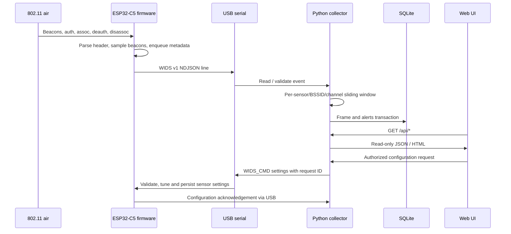

# Architecture and design decisions

## Goals

Create a cheap, reproducible, receive-only Wi-Fi IDS with independent RF sensors and a local desktop/SBC dashboard. Prioritise **correct characterization** of observations (not attack certainty) and long-term maintainability over sophisticated but unvalidated RF claims.

## Data plane

## Firmware components

1. `app_main` initializes NVS/event loop/Wi-Fi in STA receive mode without connecting.
2. `esp_wifi_set_band_mode` selects the configured 2.4 or 5 GHz receive band.
3. `esp_wifi_set_channel` tunes a fixed primary channel (requires regulatory/hardware validation).
4. A promiscuous management-frame callback checks subtype, copies key header fields, optionally extracts a beacon/probe SSID and queues a small fixed struct. No logging or blocking in RX callback.
5. FreeRTOS export task serializes frames to a versioned ASCII `WIDS ` + JSON line protocol. A periodic heartbeat exposes queue drops. `WIFI_PKT_DATA` and `WIFI_PKT_CTRL` are not captured or exported.

Sampled beacons mean beacon frequency counts are **not** a reliable detection metric. The counter is global across beacons and probe responses, not per BSSID. Protect against overload by tuning sample factor and queue drops.

## Collector components

- `models.py` validates wire framing/version/addresses/channel/rssi/subtypes.
- `engine.py` owns a single lock for deterministic ordering, detector, DB insert, periodic retention cleanup.
- `detection.py` observes sliding windows keyed by sensor + BSSID + channel + category. Rules are detection heuristics; they do not authenticate transmitter identity.
- `storage.py` uses SQLite WAL and a lock. No external brokers/database needed for a single sensor. Serialized writes simplify correctness for modest telemetry volume.
- `webapp.py` serves dashboard data, a Status dialog, and key-protected configuration writes with same-origin checks.
- `runtime.py` validates and atomically persists collector overrides; `sensor.py` coordinates USB commands and matching acknowledgements through the serial reader. See [configuration](CONFIGURATION.md).
- `cli.py` provides `serve`, `demo`, `replay` workflows. Demo/replay write to SQLite, **not** RF.

## Design trade-offs

| Choice | Reason | Cost |
|---|---|---|
| USB serial instead of ESP radio uplink | Reserve radio for passive capture | Tether or USB host required |
| Fixed channel instead of hopping | Fewer missed short bursts | Sensor per channel for full coverage |
| ESP-IDF/C instead of Arduino | Direct access to supported Wi-Fi APIs, bounded capture callback | SDK/toolchain overhead |
| Python/FastAPI/SQLite on Pi | Fast local iteration; explainable code | Not for large multi-site event volumes |
| Store metadata not packet bytes | Minimise privacy exposure and DB size | No PCAP-level forensics |
| Heuristic rules | Explainability and testability | False positives / blind spots |
| No transmission/injection | Pure monitoring with lower disruption risk | No active containment |

## One serial input per running collector

The repository's **default** `serial_loop` reads one port. `sensor_id` supports multi-sensor events via replay, but multi-port live fan-in is a roadmap item. Multiple independent collector processes each with their own SQLite can operate concurrently; do **not** point separate processes at the same DB without explicitly engineering shared ownership/ingest ordering. An easy deployment is one Pi per sensor or an extension to launch multiple serial threads sharing one `Engine`.

## Time and measurement quality

The ESP sensor supplies monotonic uptime in milliseconds. It does **not** have authenticated UTC time. The Python host adds UTC receive timestamps (not original RF capture timestamps) when storing. All time-window rules run against **collector ingest time** rather than firmware uptime or packet timestamp. Delays/USB buffering can distort bursts. Tests and acceptance checklist should measure the practical effect before interpreting counts as reliable attack rates.

## Production hardening path

Do not expose the prototype over the WAN. Add authenticated sensor transport, centrally managed identities, structured logs and metrics, a real network time model, collection backpressure management, and rigorous target-hardware compilation + RF test coverage before any wider deployment.
